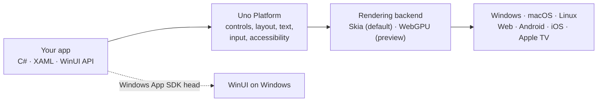

<p align="center">
  <a href="https://platform.uno">
    
  </a>
</p>

<h3 align="center">One C# and XAML codebase. Every screen your users have.</h3>

<p align="center">
  Uno Platform is the open-source .NET platform for building apps that run on <b>Windows, macOS, Linux, the web, Android, iOS and Apple TV</b>, using the WinUI API and the C# and XAML skills you already have.
</p>

<p align="center">
  <a href="https://www.nuget.org/packages/Uno.Sdk/"></a>
  <a href="https://uno-platform.visualstudio.com/Uno%20Platform/_build?definitionId=5"></a>
  <a href="https://www.nuget.org/packages/Uno.WinUI/"></a>
  <a href="https://github.com/unoplatform/uno"></a>
  <a href="https://github.com/unoplatform/uno/graphs/contributors"></a>
  <a href="https://platform.uno/discord"></a>
  <a href="License.md"></a>
</p>

<p align="center">
  <a href="https://aka.platform.uno/get-started"><b>Get started</b></a> ·
  <a href="https://aka.platform.uno/uno-docs-intro">Documentation</a> ·
  <a href="https://gallery.platform.uno/">Gallery</a> ·
  <a href="https://github.com/unoplatform/uno.samples">Samples</a> ·
  <a href="https://platform.uno/blog/">Blog</a> ·
  <a href="https://platform.uno/discord">Discord</a>
</p>

---

## 💜 Why Uno Platform

- **Write it once, for real.** One single-project app, one set of XAML pages, one set of view models. Uno Platform takes care of each platform's window, input, accessibility and packaging.
- **The WinUI API, everywhere.** You use the same `Microsoft.UI.Xaml` controls, styles, data binding and Composition API as on Windows. Controls are increasingly ported from WinUI's own C++ sources, and the default styles come from WinUI's own `generic.xaml`.
- **Consistent by design.** Uno Platform draws the UI itself, so your app looks and behaves consistently on a phone, in a browser and on the desktop. You can still embed native views where you need them, such as a map or a platform SDK control.
- **A fast inner loop.** Hot Reload updates XAML and C# in your running app, and AI agents can read the docs and drive your live app through the Uno Platform MCPs.
- **Free and open source.** Uno Platform is licensed under Apache 2.0, and developed in the open, right here.

## 🚀 Quick start

You need the [.NET SDK](https://dotnet.microsoft.com/download). Then let [Uno.Check](https://aka.platform.uno/uno-check) install the workloads for the platforms you target, and create an app:

```bash
dotnet tool update -g uno.check
uno-check

dotnet new install Uno.Templates
dotnet new unoapp -o MyApp

cd MyApp/MyApp
dotnet run -f net10.0-desktop
```

Prefer an IDE? Uno Platform has extensions for [**Visual Studio**](https://aka.platform.uno/vs-extension-marketplace), [**Visual Studio Code**](https://aka.platform.uno/vscode-extension-marketplace) and [**JetBrains Rider**](https://aka.platform.uno/rider-extension-marketplace), and a [live project wizard](https://aka.platform.uno/app-wizard) to choose your platforms and features. The [getting started guide](https://aka.platform.uno/get-started) walks you through each setup.

## 🖥️ Where your app runs

| Platform | Target framework | Notes |
|---|---|---|
| **Windows** | `net10.0-desktop` | Rendered by Uno Platform in a Win32 window |
| | `net10.0-windows10.0.19041` | Runs on WinUI itself, through the Windows App SDK |
| **macOS** | `net10.0-desktop` | Metal-accelerated |
| **Linux** | `net10.0-desktop` | X11, or the framebuffer for embedded devices |
| **Web** | `net10.0-browserwasm` | WebAssembly, in desktop and mobile browsers |
| **Android** | `net10.0-android` | Android 7.0 (API 24) and later |
| **iOS and iPadOS** | `net10.0-ios` | iOS 15 and later |
| **Apple TV** | `net10.0-tvos` | tvOS 15 and later |

Apps target .NET 10, the current long-term support release. The [supported platforms page](https://platform.uno/docs/articles/getting-started/requirements.html) has the full details.

## 🛠️ How it works



Uno Platform implements the WinUI API on top of a single rendering pipeline. Each platform gets a thin host for its window, input and system services, and the UI itself is drawn through a pluggable rendering backend. Skia is the default, and WebGPU is available as an opt-in preview. On Windows, you can also build the same app against WinUI itself.

## ✨ New in Uno Platform 7.0

<!-- TODO: link the Uno Platform 7.0 release blog post here once it is published. -->

- 🎨 **One drawn UI everywhere.** The native mobile and browser-DOM renderers are gone: every Uno Platform target now draws the UI through the same pipeline, so a fix lands on every platform at once. [Native views](https://platform.uno/docs/articles/features/using-skia-hosting-native-controls.html) can still be embedded on Android, iOS, WebAssembly, Windows and Linux.
- 🧱 **Pluggable rendering.** Skia stays the default, and a new WebGPU backend is available as an opt-in preview.
- 📺 **Apple TV.** tvOS is now a fully implemented, supported target. Add `net10.0-tvos` to your target frameworks.
- ✍️ **Rich text.** `RichTextBlock` is rebuilt on a port of WinUI's core text stack, and [`RichEditBox`](doc/articles/controls/RichEditBox.md) now works on every Uno Platform-rendered target.
- 🧩 **More of WinUI, ported.** `ItemsRepeater` and `ItemsView` are re-synced with WinUI's sources, `LinedFlowLayout` is new, and [Lottie](doc/articles/features/Lottie.md) is built in through a port of `AnimatedVisualPlayer`.
- 🧈 **Smoother scrolling.** Scrolling and flings now advance on the compositor's frame clock, so on a 120 Hz screen content can move every frame.
- 📦 **Leaner and simpler.** A much smaller `Uno.WinUI` package, fewer packages to restore, and `Uno.Sdk` single-project apps as the one project format.

Upgrading from 6.x? The [migration guide](doc/articles/migrating-to-uno-7.md) walks through every breaking change.

<!-- TODO: switch the relative doc links above to platform.uno/docs once the 7.0 documentation is published. -->

## 🧰 Tools for a productive dev loop

- **[Hot Reload](https://aka.platform.uno/hot-reload)**: change XAML and C# while your app runs, without losing its state.
- **[Uno Platform MCPs](https://aka.platform.uno/mcp)**: give AI agents up-to-date Uno Platform documentation, and let them see and interact with your running app. There are step-by-step guides for [Claude Code](https://platform.uno/docs/articles/get-started-ai-claude.html), [GitHub Copilot CLI](https://platform.uno/docs/articles/get-started-ai-gh-copilot-cli.html), [Codex](https://platform.uno/docs/articles/get-started-ai-codex.html) and [Cursor](https://platform.uno/docs/articles/get-started-ai-cursor.html).
- **[Uno Platform Studio](https://aka.platform.uno/studio)**: a separate productivity suite from the Uno Platform team. It includes [Hot Design®](https://aka.platform.uno/hot-design), which turns your running app into a visual designer, the [Studio Agent](https://aka.platform.uno/studio-agent), and the [Figma plugin](https://aka.platform.uno/Design-to-Code) for design-to-code. Hot Reload and the MCPs are included in the free Community plan; see [the plans](https://platform.uno/select-subscription/) for the rest.

<p align="center">
  
</p>

## 🌱 Ecosystem

| Project | What it gives you |
|---|---|
| [Uno.Extensions](https://github.com/unoplatform/uno.extensions) | Hosting, navigation, configuration, HTTP, authentication, localization and logging |
| [Uno.Toolkit](https://github.com/unoplatform/uno.toolkit.ui) | Extra controls and helpers, such as `AutoLayout`, `TabBar` and `DrawerFlyout` |
| [Uno.Themes](https://github.com/unoplatform/uno.themes) | Material, Cupertino and Simple themes, on top of the built-in Fluent styles |
| [Uno.Samples](https://github.com/unoplatform/uno.samples) | Sample apps and tutorials for specific features |
| [Uno Gallery](https://gallery.platform.uno/) | Every control and theme, live in your browser ([source](https://github.com/unoplatform/uno.gallery)) |
| [Uno Chefs](https://github.com/unoplatform/uno.chefs) | A complete reference app, built with the recommended practices |

Uno Platform apps also work with the [Windows Community Toolkit](https://aka.platform.uno/install-uno-community-toolkit), CommunityToolkit.Mvvm, SkiaSharp and [many other libraries](https://aka.platform.uno/supported-libraries).

## 🤝 Contributing

Uno Platform is built in the open, and contributions of every size are welcome: bug reports, docs fixes, samples, new controls.

There has never been a better time to start. With one rendering pipeline, a control has one implementation, so a fix lands on every platform at once. A single `Uno.Sdk` SamplesApp targets every platform, and doubles as the runtime-test runner. Many controls are ported from WinUI's C++ sources into C# files that mirror the original headers (`.h.mux.cs`, `.mux.cs`), so if you know where something lives in WinUI, you can usually find it here.

1. Read the [contribution guide](CONTRIBUTING.md) and [Contributing to Uno Platform](https://platform.uno/docs/articles/uno-development/contributing-intro.html).
2. Build the repository with [Building Uno.UI](https://platform.uno/docs/articles/uno-development/building-uno-ui.html), and try your change in the [SamplesApp](https://platform.uno/docs/articles/uno-development/working-with-the-samples-apps.html).
3. Pick a [good first issue](https://github.com/unoplatform/uno/issues?q=is%3Aissue%20is%3Aopen%20label%3A%22good%20first%20issue%22), or tell us what you'd like to work on.

Working with an AI coding agent? The repository's [AGENTS.md](AGENTS.md) and [`.claude`](.claude) folder describe the build rules, platform targeting, runtime tests and samples, so your agent follows the same conventions we do.

## 💬 Community and support

- Chat with the team and the community on [Discord](https://platform.uno/discord).
- Ask questions and share ideas in [GitHub Discussions](https://github.com/unoplatform/uno/discussions).
- Report bugs and request features in [GitHub Issues](https://github.com/unoplatform/uno/issues/new/choose).
- Follow the [blog](https://platform.uno/blog/), [X](https://x.com/unoplatform) and [YouTube](https://www.youtube.com/@unoplatform) for news and deep dives.
- Need help shipping? See [professional support](https://platform.uno/support/) and [case studies](https://platform.uno/case-studies/).

## 💐 Thanks to our contributors

[](https://github.com/unoplatform/uno/graphs/contributors)

Made with [contrib.rocks](https://contrib.rocks).

## 📄 License

Uno Platform is licensed under the [Apache 2.0 License](License.md). Please read our [Code of Conduct](CODE_OF_CONDUCT.md) before participating, and report security issues as described in [SECURITY.md](SECURITY.md).
