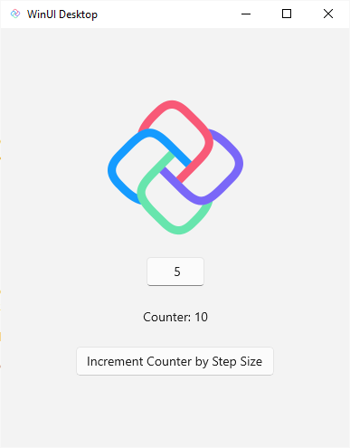

<!-- markdownlint-disable MD001 -->

# Create a Counter App with Uno Platform

The Counter tutorial will walk you through creating a simple cross-platform counter application with Uno Platform.

  

Four variants of the Counter tutorial combine a markup language (XAML or C# Markup) with a presentation framework (MVVM or MVUX). Two more variants take a different approach: Reactor, a declarative, component-based C# UI framework, and our visual designer, Hot Design.

<a href="get-started-counter-xaml-mvux.md">

#### XAML + MVUX

Use XAML for layout and MVUX for state management

</a>

<a href="get-started-counter-xaml-mvvm.md">

#### XAML + MVVM

Use XAML for layout and MVVM for state management

</a>

<a href="get-started-counter-csharp-mvux.md">

#### C# Markup + MVUX

Use C# Markup for layout and MVUX for state management

</a>

<a href="get-started-counter-csharp-mvvm.md">

#### C# Markup + MVVM

Use C# Markup for layout and MVVM for state management

</a>

<a href="get-started-counter-reactor.md">

#### Reactor

Use Reactor components for layout and state management

</a>

<a href="../../studio/Hot Design/hot-design-getstarted-counter-tutorial.md">

#### Hot Design

Use a visual designer to design and develop the app

</a>

 

---
