# 060 — Hot Reload and dev-server: architecture reference

> State as of 2026-10-19. This is the reference for how an edit reaches the screen: when the code diverges, update
> the diagrams here to say so rather than leaving them stale.

The dev-server (RemoteControl host) receives edits, keeps a Roslyn workspace per connected app, emits
Edit-and-Continue (EnC) deltas and pushes them to the running app. From July to September 2026 the work
on it was one campaign against one defect class: an update the pipeline accepts, then never applies,
without telling anyone (specs 047 to 055). A regression in any of these gates shows up only as "Hot Reload
does nothing". Other consumers of `Uno.HotReload` exist outside this repository.

## TL;DR

- **Hot Reload does nothing? Set `UnoHotReloadDiagnosticsLogPath` in the app's csproj first**: the dev-server then
  dumps Roslyn's Edit-and-Continue logs and MSBuild binlogs there. Steps in
  [First steps when Hot Reload does nothing](#first-steps-when-hot-reload-does-nothing).
- Specs 047 to 055 are merged. The last piece, [uno#24617](https://github.com/unoplatform/uno/pull/24617) (spec 055 R1, "requested" is not "applied"), merged 2026-09-28. Spec 051 (baseline identity handshake) is a draft, not implemented.
- Two root-cause issues stay open, each with the proof of why the naive fix fails: [#24204](https://github.com/unoplatform/uno/issues/24204) (cache-friendly incremental generators) and [#24207](https://github.com/unoplatform/uno/issues/24207) (share workspaces by solution + baseline + TFM).
- Active workaround: the server withdraws the `AddFieldRva` EnC capability in `AddImplicitCapabilities` ([code](../../src/Uno.HotReload/Microsoft/WatchHotReloadService.cs#L112-L133)) to dodge a CoreCLR defect. The upstream fix [dotnet/runtime#131753](https://github.com/dotnet/runtime/pull/131753) is merged but, as of 2026-08, not shipped in .NET 10.
- Memory: the host now runs a Workstation GC profile, caps workspaces at 5 and reaps dead sockets (3 PRs, backported to 6.7).
- [uno#24085](https://github.com/unoplatform/uno/pull/24085) merged 2026-10-15: on Roslyn 5.x a rude edit was committed as the next baseline, so every later edit reported `Success` and was lost until restart. The baseline is now committed only when the emit hands out deltas.
- Open field issues (multi-TFM workspaces on CI, 7.0 dev-server issues, Rider's own Hot Reload) are listed in [Open items](#open-items) with what is known of each.

## Architecture

Three processes, two channels. Which process computes the delta depends on how the app was launched: that is the
**mode**, decided by the app at startup (A, B and C below).

### Big picture

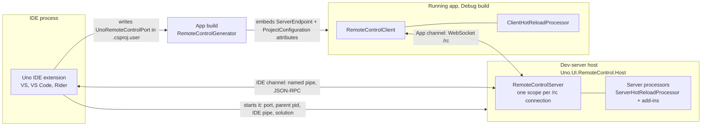

- The **IDE channel** carries IDE messages: file updates and force-HR for VS (mode A), deltas for the debugger
  (mode C), status for the IDE indicator (`DevelopmentEnvironmentStatusIdeMessage`), HR events reported by the IDE.
- The **App channel** carries frames: `ConfigureServer`, `AssemblyDeltaReload`, `UpdateFileRequest`/`Response`,
  `HotReloadStatusMessage`, `HotReloadClientOperationEvent`, keep-alives.
- A **processor** is code loaded next to the app (client processors, found by reflection at startup) or into the
  dev-server (server processors, loaded from a folder the app names in `ProcessorsDiscovery`). It is the extensibility
  point: Hot Reload is one, so a feature ships without rebuilding the dev-server and without a
  deep dependency in the app.
- The host dies with its parent (`--ppid`). The app finds it through `UNO_DEV_SERVER_HOST` / `UNO_DEV_SERVER_PORT`
  when both are set, otherwise through the embedded `ServerEndpointAttribute` and the platform's host candidates.

### Startup and end of a connection

The server-side Hot Reload processor lives exactly as long as the app's connection (its activation bar below): it is
created when the app connects and disposed, with its workspace, when the app goes away.

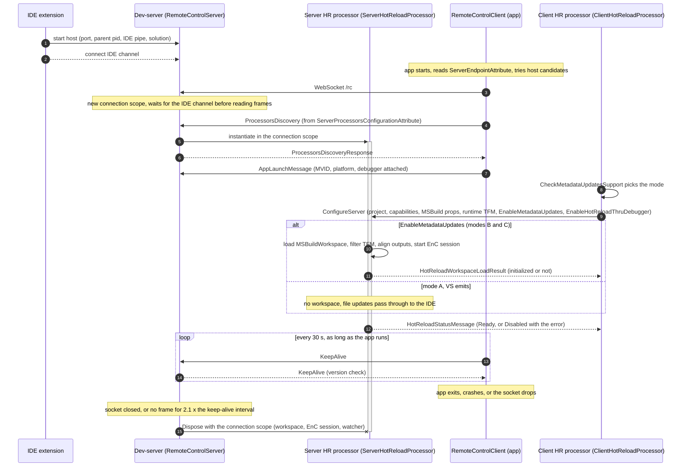

Connection scope and frame loop: [RemoteControlServer.cs](../../src/Uno.UI.RemoteControl.ServerCore/RemoteControlServer.cs)
(one instance per connection, processors disposed in `Dispose`). The processor's `Dispose` unregisters it from the
workspace cap and cancels the workspace, which disposes the `HotReloadManager` and the file watcher.

The client does not wait for `ProcessorsDiscoveryResponse` before sending `ConfigureServer`; the server reads frames in
order and finishes the discovery first, so the processor exists when `ConfigureServer` reaches it
([RemoteControlClient.cs](../../src/Uno.UI.RemoteControl/RemoteControlClient.cs)).
The server side of `ConfigureServer` is
[`ProcessConfigureServer`](../../src/Uno.UI.RemoteControl.Server.Processors/HotReload/ServerHotReloadProcessor.cs#L311-L346);
the workspace load is
[`InitializeMetadataUpdater`](../../src/Uno.UI.RemoteControl.Server.Processors/HotReload/ServerHotReloadProcessor.MetadataUpdate.cs#L38-L55).

### Mode A: Visual Studio emits

App built inside Visual Studio (`BuildingInsideVisualStudio`), on desktop and WebAssembly, and on mobile with the
debugger attached. The dev-server holds no workspace: it only relays file updates to VS and asks VS to apply.

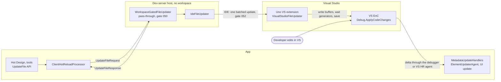

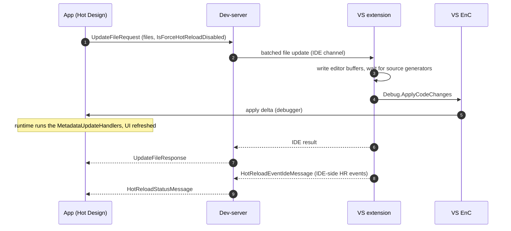

Code: [`CreateFileUpdater`](../../src/Uno.UI.RemoteControl.Server.Processors/HotReload/ServerHotReloadProcessor.cs#L109-L159)
(VS gets `IdeFileUpdater`, everyone else writes to disk),
[`VisualStudioFileUpdater`](../../src/Uno.UI.RemoteControl.VS/VisualStudioFileUpdater.cs),
`ForceHotReloadIdeMessage` handled in [EntryPoint.cs](../../src/Uno.UI.RemoteControl.VS/EntryPoint.cs).
A developer's own edit never goes through the dev-server in this mode: VS applies it itself.

- **The source of truth is VS's editor, not the disk.** VS emits from its in-memory buffers, so an edit does not need
  to be saved to be applied, and the dev-server cannot know what was sent.
- **An `UpdateFileRequest` is correlated by time, not by identity.** The server opens an operation before handing the
  files to VS, and every HR event VS reports until success or failure is attributed to it. If the developer edits in
  VS at the same moment, both land in the same operation. The client's `UpdateFile` API waits for that operation with
  a timeout and fails when it does not complete in time. Its users are design tools and the HR tests.
- **Why not mode B everywhere.** It would be one code path to maintain, but VS applies deltas through its own
  debugger, from buffers the dev-server cannot see: the only option is to integrate with it.

### Mode B: the dev-server emits

App started without a debugger outside VS (VS Code, Rider, CLI, an agent), or `UnoHotReloadMode=MetadataUpdates`.
The dev-server watches the disk, emits the delta and pushes it to the app, which applies it itself.

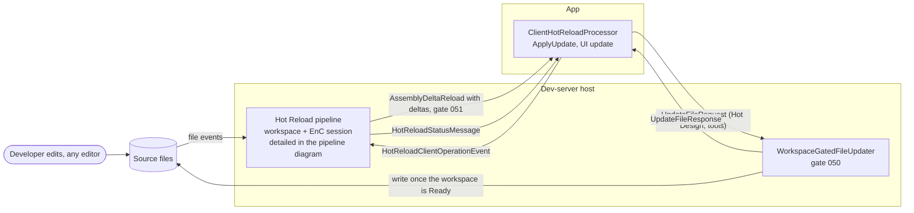

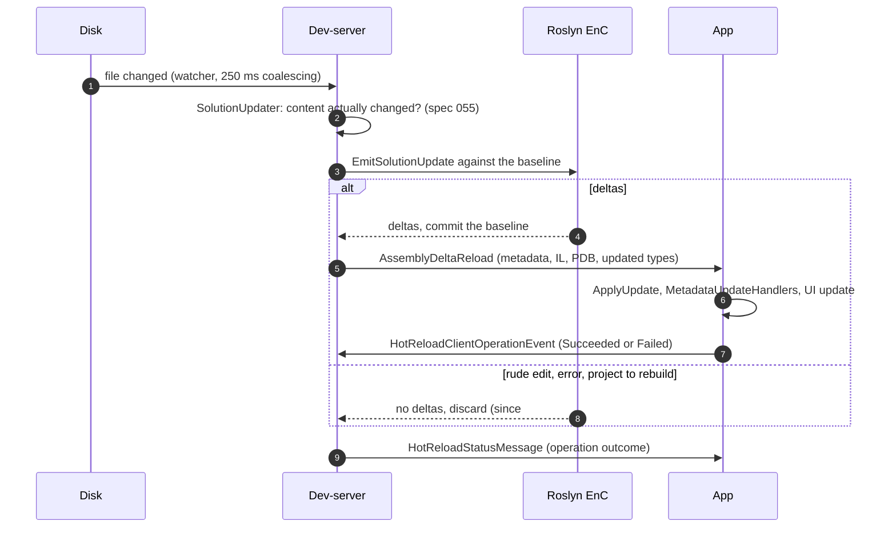

Code: [`SendUpdates`](../../src/Uno.UI.RemoteControl.Server.Processors/HotReload/ServerHotReloadProcessor.MetadataUpdate.cs#L173-L224),
[`Uno.HotReload`](../../src/Uno.HotReload) (`HotReloadManager`, `IO/`, `Diffing/`, `Microsoft/`).

### The Hot Reload pipeline, from a file event to the app

Shared by modes B and C. One pass at a time
per connection; each node carries the gate that guards it.

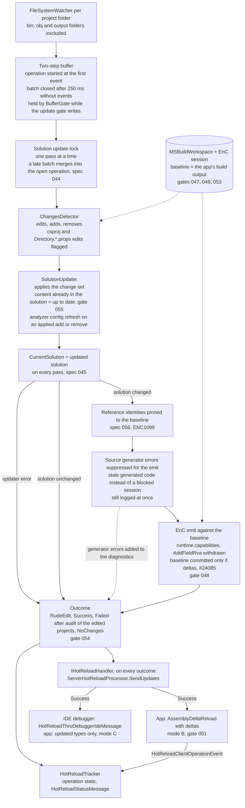

Code: [`FileSystemObserver`](../../src/Uno.HotReload/FileSystemObserver.cs),
[`HotReloadManager.ProcessFileChanges` and `ProcessSolutionChanged`](../../src/Uno.HotReload/HotReloadManager.cs#L153-L452),
[`Diffing/`](../../src/Uno.HotReload/Diffing),
[`WatchHotReloadService.Emit.cs`](../../src/Uno.HotReload/Microsoft/WatchHotReloadService.Emit.cs),
[`Tracking/`](../../src/Uno.HotReload/Tracking).

- The operation starts at the **first** file event, before the 250 ms batch closes, so the app sees "processing"
  immediately.
- **Additive, hence the lock.** Each delta is computed against the solution of the previous pass, which is the code
  the app now runs. A pass is never aborted: if file D changes while A, B and C are being emitted, the pass for A, B, C
  completes (solution 2, even in error) before D is processed against it (solution 3). Computing D against solution 1
  would silently drop A, B and C. An agent writing files continuously therefore gets one pending operation at a time.
- **What counts as a change.** A file outside the projects (`a.txt`) is ignored. A new `.cs` file is checked against
  a temporary workspace (`TemporarySolutionAddDetector`), because the csproj may exclude it by glob.
- The solution is committed on **every** pass, even when nothing is emitted: an updater may have re-bound references
  (a package added) that the next pass needs.
- The emit runs only when the solution actually changed; "no change" and an updater error short-circuit to the
  outcome without touching the EnC session.
- `Failed` with no deltas is decided by auditing only the projects that own the edited files (spec 054): the rest of
  the solution may have unrelated errors.
- Source generator errors do not block the emit (Roslyn 5.x would refuse any update while one is present) but are
  not hidden either: they are logged when found and carried in the operation's diagnostics, whatever the outcome.
  An agent that wrote an invalid XAML file still gets an updated app and the exact error to fix.
- **Generators report, they do not throw.** A diagnostic carries the file and position, and several can be reported
  at once, so an agent fixes them all in one pass; an exception gives one message and stops the generator. Never
  drop a diagnostic on the way to the outcome.
- **Every outcome reaches the handler**, `NoChanges` included: an agent that edited a file and gets `NoChanges` learns
  that the file is not part of the project.

### Mode C: the dev-server emits, the debugger applies (VS Code, Uno's Mono debugger)

App started from VS Code under Uno's Mono debugger (WebAssembly, Android, iOS): once a debugger is attached, the
runtime refuses the app's own `ApplyUpdate` calls, so the delta has to go through the debugger. (The same rule makes
the secondary app of the runtime tests impossible to debug.) The client sets `EnableHotReloadThruDebugger` in `ConfigureServer`.

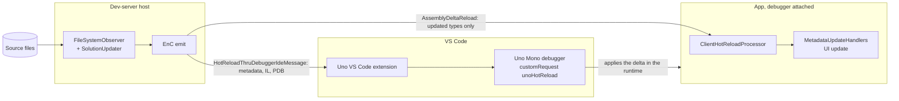

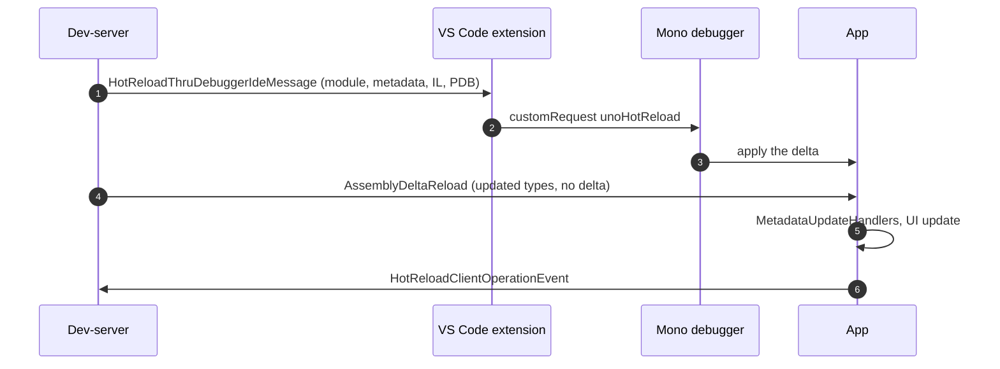

If no IDE is connected, the server fails the update: *"No active connection with the IDE to send update thru
debugger"*. Code: the `_useHotReloadThruDebugger` branch of
[`SendUpdates`](../../src/Uno.UI.RemoteControl.Server.Processors/HotReload/ServerHotReloadProcessor.MetadataUpdate.cs#L188-L212),
and its handler in the Uno VS Code extension.

### Other producers

- **Outside this repository**, other consumers of `Uno.HotReload` reuse mode B's message protocol.
- **No producer**: mobile launched from VS without a debugger, or Rider and VS Code's CoreCLR debugger attached. The
  app reports Hot Reload as unavailable; see [With and without a debugger](#with-and-without-a-debugger).

### Connection lifecycle

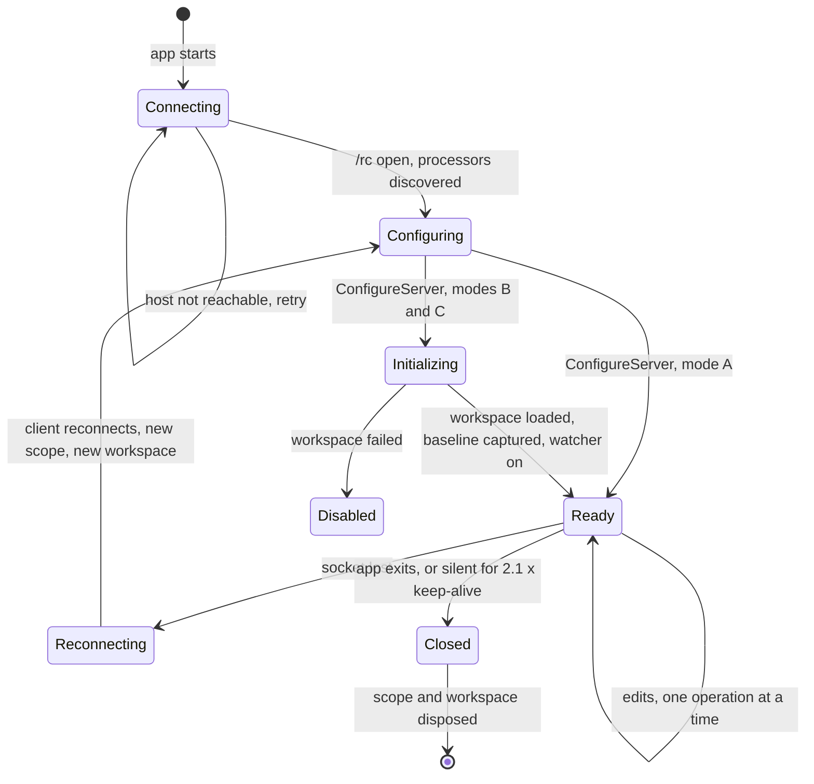

- Each `/rc` connection owns its DI scope, workspace and EnC `DebuggingSession` (~330 to 900 MB, per
  [#24205](https://github.com/unoplatform/uno/issues/24205)). A reconnect starts over: new workspace, new baseline.
- At most 5 live workspaces (`HotReload:MaxConcurrentWorkspaces`, [#24240](https://github.com/unoplatform/uno/pull/24240)).
  To free memory the server disposes the workspace and keeps the socket: closing it makes the client retry in a loop.
- Update requests that arrive while the workspace is `Initializing` are queued (30 s TTL); after `Failed` they fail
  at once with a typed `NotAvailable` (spec 050).
- **The HR indicator is rebuilt from events.** Nothing sends "the state": the app aggregates status messages,
  operation events and keep-alives into an effective state, and missing keep-alives are how it shows a dropped
  connection. This aggregation is complex and is where indicator bugs live.

## Update strategies and their limits

An edit becomes a screen update in three steps, and each one has its own strategy.

**1. Who produces the delta.** Exactly one producer per app, chosen once at startup by
[`CheckMetadataUpdatesSupport`](../../src/Uno.UI.RemoteControl/HotReload/ClientHotReloadProcessor.Agent.cs#L87-L132):
- **Mode A, Visual Studio's own EnC**: VS compiles and applies the delta. The dev-server only relays IDE messages
  (gate 052).
- **Mode B, the dev-server workspace**: an `MSBuildWorkspace` with an EnC session per app connection, fed by the file
  watcher; the delta goes to the app in `AssemblyDeltaReload`.
- **Mode C, the dev-server through the debugger**: same emit as B, applied by Uno's Mono debugger in VS Code.
- `UnoHotReloadMode=MetadataUpdates` (MSBuild) forces the dev-server path whatever the IDE.

There is no XAML-only or "partial" mode any more: `HotReloadMode` is `None` or `MetadataUpdates`
([HotReloadMode.cs](../../src/Uno.UI.RemoteControl/HotReload/HotReloadMode.cs)).
XAML is hot reloaded as C#: the XAML generator runs in the workspace and its output is diffed like any source.

**2. Applying the delta.** In mode B the app calls `MetadataUpdater.ApplyUpdate` itself, on the module matched by
MVID; in modes A and C the debugger applies it. Never call it directly from other code: the `MetadataUpdateHandler`s would not run.

**3. Updating the UI.** Detailed in [The UI update pipeline](#the-ui-update-pipeline) below: resources first, then the
visual tree, each phase pausable.

**Limits, all silent unless a gate reports them:**
- **Rude edits.** Whatever the runtime's EnC capabilities reject (signature changes, interface members, some field
  edits) needs a restart. Capabilities come from the app at `ConfigureServer`; `AddFieldRva` is withdrawn on purpose
  (CoreCLR defect, see below).
- **Recreated types.** Code that still holds the old type fails at the cast:
  `InvalidCastException: Unable to cast 'LoginModel#1' to 'LoginModel'`
  ([uno.extensions#2903](https://github.com/unoplatform/uno.extensions/issues/2903), navigation from code-behind after HR).
- **Debug builds only.** A Release or linked app has no EnC support; on WASM the IL linker disables Hot Reload
  (`UNO_BOOTSTRAP_LINKER_ENABLED`, logged as an error at startup).
- **Baseline drift.** The server commits the EnC baseline when it emits, before the app acknowledges. Since
  [#24085](https://github.com/unoplatform/uno/pull/24085) a rejected emit is discarded instead of committed, but an
  emit the app then fails to apply still moves the baseline.

## The UI update pipeline

Once the runtime holds the new code, nothing on screen has changed yet: the old instances still run the old layout.
Refreshing them is Uno's job, in the app, in the same code whatever the mode.

**Entry point.** `ClientHotReloadProcessor.UpdateApplication(Type[] types)` is a .NET `MetadataUpdateHandler`. The
runtime calls it after a delta is applied: by the debugger in modes A and C, by `HotReloadAgent` right after
`ApplyUpdate` in mode B. The `types` are the ones the delta touched.

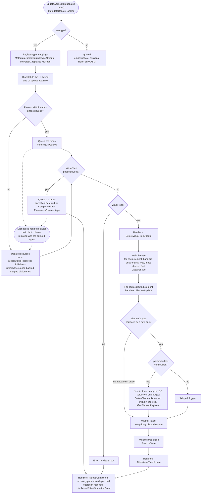

- **Resources before the tree.** Updated `GlobalStaticResources` types are re-initialised in the order
  `App.InitializeComponent` uses, then every merged dictionary whose source was rebuilt is refreshed, in the host
  application's resource tree and in every secondary application's (an app hosted in its own ALC is never
  `Application.Current`). The visual tree pass then picks up the new
  resources.
- **Two kinds of update per element.** An element whose type was recreated (`[CreateNewOnMetadataUpdate]`, the
  runtime emits `MyPage#1` with a `MetadataUpdateOriginalTypeAttribute`) is **replaced**: new instance through its
  parameterless constructor, dependency-property values copied (Uno targets), swapped in place. Any other element whose type has a
  handler is **updated in place** through that handler's `ElementUpdate`. An element whose own type is in the update
  list but not recreated (a nested type changed, such as a `DataTemplate` inside a dictionary) is not replaced.
- **The UI thread is registered at startup.** `Window.UseStudio()` registers the window, hence the dispatcher the UI
  update runs on; without it `UpdateApplication` reports an error and nothing is refreshed.
- **State is the handlers' job.** Two walks: the first captures state per element before the swap, the second
  restores it after a layout turn. Example: the `ScrollViewer` handler records the vertical offset of each named
  `ScrollViewer` of the page being replaced, and the second walk restores it on the `ScrollViewer` of the same name in
  the new page. What survives a reload (scroll offset, selection, navigation stack) is whatever a
  handler captured.
- **Handlers.** Declared with `[assembly: ElementMetadataUpdateHandler(typeof(TElement), typeof(THandler))]`, matched
  by name so a library can define its own copy of the attribute. Each `ElementUpdateAgent` only loads handlers from
  assemblies of its own ALC (spec 039), so an inner app and its host do not run each other's handlers. A handler
  registered for `FrameworkElement` runs for every element. The one-argument form registers for `object`: its
  Before/After/ReloadCompleted callbacks run, but the tree walk never calls it for an element.
- **Pauses.** Why they exist: while a design tool edits a text live, the change is already applied locally in the
  visual tree, and replacing the page would lose focus and selection. The delta is applied to the runtime
  anyway (there is no choice), but the UI phases wait until the edit ends. `UIUpdate.Pause(phases)` returns a handle; while any handle holds a phase, its types queue up in
  `PendingUIUpdates`, and releasing the last handle replays both phases with the queued types (spec 041). A caller of
  `UpdateFile` can pause the visual tree for its own request only (`PauseUIPhases`); there is no session-wide pause.
- **Failure isolation.** Each element is updated in its own `try`: one failing element is reported
  (`ReportElementError`) and the others still update. The operation then fails with all the errors.

Code: [ClientHotReloadProcessor.MetadataUpdate.cs](../../src/Uno.UI.RemoteControl/HotReload/ClientHotReloadProcessor.MetadataUpdate.cs)
(`UpdateApplication`, `DoUpdateVisualTreeCore`, `UpdateGlobalResources`, `ReplaceViewInstance`),
[ElementUpdaterAgent.cs](../../src/Uno.UI.RemoteControl/HotReload/MetadataUpdater/ElementUpdaterAgent.cs),
[UIUpdate/](../../src/Uno.UI.RemoteControl/HotReload/UIUpdate).
The handler API, as documented for library authors (including content outside the visual tree):
[uno-internals-hotreload.md](../../doc/articles/uno-development/uno-internals-hotreload.md).

## With and without a debugger

From `CheckMetadataUpdatesSupport` on `master`. "VS" means the app was built inside Visual Studio
(`BuildingInsideVisualStudio`).

| Launch | Desktop (Skia, CoreCLR) | WebAssembly (Mono) | Android, iOS (Mono) |
|---|---|---|---|
| VS, with debugger | VS EnC | VS EnC | VS EnC |
| VS, without debugger | VS Hot Reload | VS Hot Reload | **none** |
| VS Code or Rider, without debugger | dev-server | dev-server | dev-server |
| VS Code with Uno's Mono debugger (`__UNO_SUPPORT_DEBUG_HOT_RELOAD__`) | n/a (CoreCLR) | dev-server | dev-server |
| VS Code (CoreCLR debugger) or Rider, with debugger | **none** | **none** | **none** |
| `UnoHotReloadMode=MetadataUpdates` | dev-server | dev-server | dev-server |

- With a debugger attached outside those cases, a delta that still arrives is refused with *"Hot Reload is not
  supported when the debugger is attached"*.
- **Rider with debugger** is not supported yet: Rider's own Hot Reload does not invoke the `MetadataUpdateHandler`s, so
  Uno is never told the app changed and cannot refresh the UI (JetBrains [RIDER-124189](https://youtrack.jetbrains.com/issue/RIDER-124189)).
- The app logs its decision at Debug level: `Metadata updates supported: … (dev server: …, VS: …)`. That line is the
  first thing to read when "Hot Reload does nothing".

## Platform differences

| Platform | Runtime | What differs |
|---|---|---|
| Desktop (Skia) | CoreCLR | Fullest EnC capability set; the `AddFieldRva` CoreCLR defect lives here. The reference target for the HR runtime tests in CI |
| WebAssembly | Mono (browser) | Needs the `hot_reload` runtime component and `DOTNET_MODIFIABLE_ASSEMBLIES=debug`; linker disables HR; Mono `hot_reload.c` assertions surface as a runtime crash, not an exception |
| Android, iOS | Mono | Needs a debugger under VS (table above). The app must reach the dev-server from the device or emulator (host candidates: [#24805](https://github.com/unoplatform/uno/issues/24805)) |

## Known failures and how to diagnose them

### First steps when Hot Reload does nothing

> [!IMPORTANT]
> **Turn on the diagnostics dump before anything else.** In the app's csproj (Debug):
>
> ```xml
> <PropertyGroup>
>   <UnoHotReloadDiagnosticsLogPath>C:\temp\hr-logs</UnoHotReloadDiagnosticsLogPath>
> </PropertyGroup>
> ```
>
> Rebuild (the property is embedded at build time and sent in `ConfigureServer`) and restart the app. The dev-server
> then writes into that folder Roslyn's Edit-and-Continue logs (`Microsoft_CodeAnalysis_EditAndContinue_LogDir`) and
> the MSBuild binlogs of its workspace (`MSBUILDDEBUGENGINE`, `MSBUILDDEBUGPATH`). Modes B and C only: in mode A the
> deltas come from Visual Studio, which has its own logs. Code:
> [`HotReloadEnvironment.EnableLogging`](../../src/Uno.HotReload/HotReloadEnvironment.cs).

1. **Which mode?** Read the app's Debug log line `Metadata updates supported: … (dev server: …, VS: …)`
   ([table](#with-and-without-a-debugger)). "none" explains everything else.
2. **Did the workspace load?** The dev-server log says `Failed to initialize compilation workspace, hot-reload is
   disabled` when it did not; the binlogs from the dump say why (gates 047, 049, 053).
3. **Was a delta emitted?** The dev-server log `Found N metadata updates` for the edit. Zero with no rude edit is a
   change the workspace did not see (gate 055, the change detector) or a no-op.
4. **Was it applied?** The app log `[HotReload] UpdateApplicationCore called with N type(s)` means the runtime took
   the delta. Deltas sent but no such line: the delta did not match the module the app loaded (MVID, gate 051), most
   often a workspace built differently from the app (gate 047).
5. **Did the UI follow?** A paused phase (`VisualTree update DEFERRED — … Paused by: …`), a missing visual root, or an
   element without a parameterless constructor ([UI update pipeline](#the-ui-update-pipeline)).
6. **Do not trust the indicator**: the reported status is not proof (see Known traps). Diagnose on a `blank` app, whose
   early client logs are not lost.

### The nine gates: "accepted, never applied, silently"

The Where column names the step; its gate number appears in that node of the pipeline diagram (050 and 051 in
mode B, 052 in mode A). Most are "detected, never applied"; 054 and 055 are the mirror, "applied, reported failed". Specs to read first are in **bold**.

| Where | Spec | What went silent | Fix | PR |
|---|---|---|---|---|
| Workspace load | **[047](../047-hotreload-workspace-single-tfm/spec.md)** | Head TFM lost in the build-time property chain: every TFM flavor loads, the non-running ones block updates or kill init | Property whitelist, keep only the flavor matching the TFM the app reports at runtime | [#23692](https://github.com/unoplatform/uno/pull/23692) |
| EnC emit | [048](../048-implicit-codebehind-sealed/spec.md) | Generated code-behind `public partial` vs template `public sealed partial`: rude edit ENC0004 | Generated code-behind emitted `sealed` | [#23709](https://github.com/unoplatform/uno/pull/23709) |
| Workspace load | [049](../049-hotreload-workspace-missing-targeting-pack/spec.md) | Stale workload manifest, targeting pack missing: flavor has no BCL refs, zero `WorkspaceFailed` diagnostics | Detect, `dotnet restore` once in the BuildHost's SDK context, else warn with remediation | [#23781](https://github.com/unoplatform/uno/pull/23781) |
| Update gate | **[050](../050-hotreload-updatefile-workspace-gate/spec.md)** | `UpdateFile` before the baseline read is absorbed into it, or lands before the watcher exists; request reported OK | Queue until workspace Ready (state machine, 30 s TTL, typed `NotAvailable`) | [#23789](https://github.com/unoplatform/uno/pull/23789), client side [#23845](https://github.com/unoplatform/uno/pull/23845) |
| Delta to the app | [051](../051-hotreload-baseline-identity-handshake/spec.md) | Baseline readable but not the module the app loaded (MVID): app drops the delta, or EnC sees "project not built" | Draft: app reports module MVIDs, server picks baseline by identity. Shipped instead: RID-specific baseline alignment | [#23799](https://github.com/unoplatform/uno/pull/23799) (alignment) |
| VS batched update | [052](../052-hotreload-ide-batched-updatefile/spec.md) | Multi-file request reaches VS as N unordered messages + fixed 500 ms force: EnC compiles a partial snapshot, modal popup | One batched IDE message, VS waits for files and generator outputs before applying | [#23846](https://github.com/unoplatform/uno/pull/23846) |
| Workspace load | **[053](../053-hotreload-workspace-analyzer-flavor-skew/spec.md)** | SDK picks `roslyn5.x` analyzer flavor, embedded Roslyn 4.x cannot load it, `GetGenerators` returns 0 silently | Pin flavor to embedded Roslyn, embed 5.x on net10, log load failures; R5/R6 capability fixes | [#23863](https://github.com/unoplatform/uno/pull/23863) |
| Outcome | [054](../054-hotreload-audit-changeset-scope/spec.md) | Audit read cached compilations of every project: `Failed` for an applied change (~2,400 unrelated errors) | Audit only the projects owning the change set | [#23864](https://github.com/unoplatform/uno/pull/23864) |
| Solution updater | **[055](../055-hotreload-noop-pass-dedup/spec.md)** | Trailing watcher event re-observes a file already applied: fork, empty emit, `Failed`; the empty update arms [roslyn#79898](https://github.com/dotnet/roslyn/issues/79898) on the next edit | `SourceText.ContentEquals` dedup returns the original solution; R1 extended to analyzer-config refresh | [#23865](https://github.com/unoplatform/uno/pull/23865), [#24617](https://github.com/unoplatform/uno/pull/24617) |

Other Hot Reload specs in `uno` from the same campaign:

| Spec | Subject | State |
|---|---|---|
| [039](../039-alc-aware-hotreload-handlers/spec.md) | HR handlers scoped per ALC, several handlers per element type | Merged 2026-03-24 with the code |
| [041](../041-hotreload-ui-pause/spec.md) | `UIUpdate.Pause` handles replace the global `TypeMappings.Pause()` | Merged 2026-05-05 with the code |
| [044](../044-hotreload-late-batch-result-loss/spec.md) | A late-merged batch's `Failed` result was discarded | [#23426](https://github.com/unoplatform/uno/pull/23426) |
| [045](../045-hotreload-handler-all-outcomes/spec.md) | `IHotReloadHandler` invoked on every outcome, not only success | [#23497](https://github.com/unoplatform/uno/pull/23497) |
| [046](../046-hotreload-client-failed-types/spec.md) | Client event reports failed type identities, not counts | Spec only ([#23478](https://github.com/unoplatform/uno/pull/23478)) |
| [056](../056-hotreload-reference-identity-pinning/spec.md) | Package add during HR: re-bound references pinned to baseline identities (Roslyn 5.6 `ENC1099`) | [#24034](https://github.com/unoplatform/uno/pull/24034) |

## Testing Hot Reload: which suite for what

Each suite covers a slice of the chain. Pick the lowest one that can show the bug; reach for the end-to-end app only
when the defect needs a real delta in a real app.

| Suite | Where | How it works | Use it when |
|---|---|---|---|
| **MetadataUpdateTests** (generator + EnC scenarios) | [`src/SourceGenerators/Uno.UI.SourceGenerators.Tests/MetadataUpdateTests`](../../src/SourceGenerators/Uno.UI.SourceGenerators.Tests/MetadataUpdateTests) | About 120 scenarios. A scenario is a folder of numbered steps (`0/`, `1/`, `2/`, …), each holding the XAML and C# files of each project (`p1/`, `p2/`) at that step. `HotReloadWorkspace` compiles step 0 with the XAML generator as the baseline, then applies each later step and emits the EnC update. `Scenario.json` gives, for each configuration (`IsDebug`, `IsMono`, `UseXamlReaderReload`), the expected number of metadata updates and the expected diagnostics for each step after the baseline | A change to the XAML generator or to generated code could turn an edit into a rude edit or into no delta (`x:Name`, `x:Bind`, `x:Load`, resources, markup extensions, two-project cases). Adding a case is a new folder and a `Scenario.json`, no code. No app runs. The most powerful one to debug a generator that breaks Hot Reload: it replays the edit exactly, without a keyboard. It is how the delegates were removed from generated code and how the XAML generators moved to diagnostics |
| **Uno.HotReload.Tests** (engine) | [`src/Uno.HotReload.Tests`](../../src/Uno.HotReload.Tests) | `HotReloadManagerHarness`: in-memory workspace, real tracker, stubbed detector, updater and emitter, so a test decides what each pass produces. `EnCHarness`: a baseline genuinely compiled to disk and the real Roslyn EnC pipeline, with the .NET 10 CoreCLR capability set | Pipeline logic: gates, outcomes, `SolutionUpdater`, file updaters, the `WatchHotReloadService` shim (rude-edit recovery, #24085), TFM filtering, reference pinning, embedded Roslyn. The most recent suite: it covers the pipeline logic, which `MetadataUpdateTests` cannot |
| **Dev-server tests** | [`src/Uno.UI.RemoteControl.DevServer.Tests`](../../src/Uno.UI.RemoteControl.DevServer.Tests) (fixture add-ins, `Uno.UI.RemoteControl.TestProcessor`), `Uno.UI.DevServer.Cli.Tests`, `Uno.UI.DevServer.Cli.E2E.Tests` | The host and its processors without an app: connection scope, processor discovery and add-in loading, workspace registry and cap, keep-alive, message serialization; CLI and MCP | Host start, protocol, add-ins, memory and connection lifetime |
| **Client tests, in process** | [`src/Uno.UI.RuntimeTests/HotReload`](../../src/Uno.UI.RuntimeTests/HotReload) (`Given_ClientHotReloadProcessor`, `Given_HotReload_UpdateResourceDictionaries`, `Given_HotReloadClientOperation_Alc`), [`src/Uno.UI.UnitTests/HotReload`](../../src/Uno.UI.UnitTests/HotReload) | Drive single steps of the client inside the SamplesApp or a unit test: no dev-server, no delta | One piece of the UI update pipeline: resource refresh counts, static and theme resources, operation tracking across ALCs |
| **Given_HotReloadWorkspace + HRApp** (end to end) | [`Given_HotReloadWorkspace.cs`](../../src/Uno.UI.RuntimeTests/HotReload/Given_HotReloadWorkspace.cs), [`HotReload/Frame/HRApp`](../../src/Uno.UI.RuntimeTests/HotReload/Frame/HRApp), `HRUnoLib` | A SamplesApp runtime test launches a separate Skia app, HRApp, next to a real dev-server. HRApp runs its own runtime tests: each edits HRApp's own source files, waits for Hot Reload, then checks the controls. The results come back as an NUnit XML file and show as one test in the SamplesApp. `HRUnoLib` is a referenced library, for edits and file adds outside the head | Behaviour of controls under HR (`Given_Frame`, `Given_DataTemplate`, `Given_TextBox`, `Given_ScrollViewer`, `Given_Popup`, `Given_UserControl`, `Given_TypeReplacement`, `Given_AppDictionary`, `Given_FileAddUpdateRemove`, `Given_HotReloadResilience`), element handlers and their state capture (the `ScrollViewer` offset restore is tested here), anything that needs a real delta. Never attach a debugger to HRApp: CoreCLR then disables Hot Reload and every test fails |

Outside `uno`:
- **Libraries** (`uno.extensions`, `uno.toolkit.ui`, themes) test their own controls under HR with the runtime tests
  engine: `[RunsInSecondaryApp]` classes and `HotReloadHelper`, in dedicated CI legs. See
  [uno.ui.runtimetests.engine](https://github.com/unoplatform/uno.ui.runtimetests.engine). Locally: `UNO_RUNTIME_TESTS_RUN_TESTS='{"Filter": {"Value": "_HotReload"}}'`.

## Key concepts

| Concept | Meaning | Source |
|---|---|---|
| Requested vs applied | `ChangeSet.HasAddOrRemove` says what was requested. Whether anything changed is decided by comparing content; the analyzer-config refresh runs only for an add/remove actually applied. The property stays: `ISolutionUpdater` has implementations outside this repository | [spec 055 R1](../055-hotreload-noop-pass-dedup/spec.md), [#24617](https://github.com/unoplatform/uno/pull/24617) |
| EnC capabilities | App sends its runtime list in `ConfigureServer`; the shim adds `AddExplicitInterfaceImplementation` (R5) and removes `AddFieldRva` (R6) | [spec 053](../053-hotreload-workspace-analyzer-flavor-skew/spec.md) |
| Baseline commit | The server commits the EnC baseline at emit, before the app acknowledges. Since #24085 it commits only an emit that hands out deltas (no error, no project to rebuild or restart) and discards the others; Roslyn 5.x says "not applicable" with `ProjectsToRebuild`, not with the status | [#24085](https://github.com/unoplatform/uno/pull/24085), [spec 053](../053-hotreload-workspace-analyzer-flavor-skew/spec.md) R6 |
| Operation outcome | `NoChanges`, `Success`, `RudeEdit`, `Failed`; handlers run on every outcome; late batches merge under the update gate | [044](../044-hotreload-late-batch-result-loss/spec.md), [045](../045-hotreload-handler-all-outcomes/spec.md) |

## Code map

| Path | Role |
|---|---|
| [`Uno.UI.RemoteControl.Host`](../../src/Uno.UI.RemoteControl.Host) | Host process, GC profile |
| [`ServerCore/RemoteControlServer.cs`](../../src/Uno.UI.RemoteControl.ServerCore/RemoteControlServer.cs), [`HotReloadWorkspaceRegistry.cs`](../../src/Uno.UI.RemoteControl.ServerCore/HotReloadWorkspaceRegistry.cs) | `/rc` sockets, keep-alive watchdog, workspace cap |
| [`ServerHotReloadProcessor.cs`](../../src/Uno.UI.RemoteControl.Server.Processors/HotReload/ServerHotReloadProcessor.cs), [`CompilationWorkspaceProvider.cs`](../../src/Uno.UI.RemoteControl.Server.Processors/Uno.Roslyn/MsBuild/CompilationWorkspaceProvider.cs) | `ConfigureServer`, file updater choice (VS or disk), workspace load |
| [`Uno.HotReload`](../../src/Uno.HotReload) | `HotReloadManager`, `IO/` (gate, updaters), `Diffing/SolutionUpdater.cs`, `Microsoft/WatchHotReloadService.cs` (EnC shim) |
| [`Uno.UI.RemoteControl/HotReload`](../../src/Uno.UI.RemoteControl/HotReload) | App client: mode choice, delta apply, UI update, status reports |
| [`Uno.UI.RemoteControl.VS`](../../src/Uno.UI.RemoteControl.VS) | VS side of IDE messages (ships in `Uno.WinUI.DevServer`) |

## Known traps

- **Reported status is not proof**: 050 reported success for edits it dropped, 054 and 055 reported `Failed` for applied ones. Compare the server log (`Found N metadata updates`) with the app's `HotReloadClientOperationEvent`.
- **Early client logs lost**: the `recommended` template configures logging in `OnLaunched`, after the RemoteControl client logs; use a `blank` app to diagnose ([uno.extensions#3170](https://github.com/unoplatform/uno.extensions/issues/3170)).
- **Release branches**: the AddFieldRva withdrawal is on `master` and `release/stable/6.7`; [#24617](https://github.com/unoplatform/uno/pull/24617) is on `master` only. Check with `git branch -r --contains <sha>` before saying a fix shipped (done for the dev-server fixes on 2026-09-04: they were missing from 6.7).
- **Do not close the socket to free memory**: the client auto-retries, causing a reconnect storm; [#24240](https://github.com/unoplatform/uno/pull/24240) disposes the workspace and keeps the socket.

## Open items

| Item | State | Next step |
|---|---|---|
| [#24204](https://github.com/unoplatform/uno/issues/24204) generators | Open. Legacy `ISourceGenerator`s re-run fully per edit (~70 MB transient per edit on a real app). Naive conversion fails: an `IIncrementalGenerator` using `.Combine(CompilationProvider)` costs the same as legacy (0.6 vs 0.03 MB per edit in the mini-repro); `XamlCodeBehindGenerator` already does it | Rewrite hot-path generators with equatable models; audit existing incremental ones for the trap |
| [#24207](https://github.com/unoplatform/uno/issues/24207) workspace sharing | Open. Two apps on one solution = two full workspaces. Naive "one workspace per solution" fails: a late-joining app has no stored deltas, and another TFM has another baseline | Key workspaces on (solution, baseline identity, TFM), accumulate deltas per target, replay to late joiners |
| [#24205](https://github.com/unoplatform/uno/issues/24205) workspace cap | Closed by [#24240](https://github.com/unoplatform/uno/pull/24240) (cap 5, `HotReload:MaxConcurrentWorkspaces`) | None; bound, not root cause |
| [dotnet/runtime#131753](https://github.com/dotnet/runtime/pull/131753) | Merged (commit `f7d4c3b`, 2026-08-05) for issue [#131752](https://github.com/dotnet/runtime/issues/131752); not in .NET 10 as of 2026-08; regression test offer left open | Track which runtime ships it and whether a .NET 10 backport is possible |
| `AddFieldRva` withdrawal | Active on `master` and 6.7 (`AddImplicitCapabilities`: [code](../../src/Uno.HotReload/Microsoft/WatchHotReloadService.cs#L112-L133), [test](../../src/Uno.HotReload.Tests/Microsoft/Given_WatchHotReloadService.cs#L43)) | Remove `.Remove("AddFieldRva")` and update the test once all runtimes Uno apps run on carry the fix |
| Apply-failure cascade | Rejected emits fixed by [#24085](https://github.com/unoplatform/uno/pull/24085) (merged 10-15, `master`). Still open: an emit the app fails to apply moves the baseline. Follow-ups: move to Roslyn's `HotReloadService` ([#25506](https://github.com/unoplatform/uno/issues/25506)), deleting a type's `.cs` file on Roslyn 5.x, ENC0033 ([#25500](https://github.com/unoplatform/uno/issues/25500)), no test of `ProjectsToRestart` on 5.x | Tie the commit to the app's acknowledgment; check the release branches before saying it shipped |
| [#23716](https://github.com/unoplatform/uno/issues/23716), [#23994](https://github.com/unoplatform/uno/issues/23994) multi-TFM workspace on CI | Open. Workspace init emitted every TFM flavor and failed on the ones not built (or not restorable on a Linux agent: `NETSDK1147`, `ENC1001`). Spec 047 ([#23692](https://github.com/unoplatform/uno/pull/23692)) and its follow-up address the cause; both issues wait for re-verification on the Toolkit canary and the Extensions HR legs | Re-run those legs on a current dev-server, close or reopen with logs |
| [uno.extensions#2903](https://github.com/unoplatform/uno.extensions/issues/2903) `LoginModel#1` cast | Open: recreated type vs generated code holding the original type | Decide which side keeps the old type (MVUX generated VM or navigation) |
| Rider's native Hot Reload | Not supported yet: Rider's own HR does not invoke the `MetadataUpdateHandler`s; blocked on JetBrains ([RIDER-124189](https://youtrack.jetbrains.com/issue/RIDER-124189)) | Track upstream |
| Spec 051 | Draft, 5 open review questions | Decide refuse vs degrade on MVID mismatch first |
| Spec 046 (failed type identities) | Spec merged, event still carries counts only | Needed only if a server must track per-view failures |
| [uno#25263](https://github.com/unoplatform/uno/issues/25263) App MCP bridge cannot keep the 7.0 host alive | Open, urgent per its report: blocks HR and App MCP for 7.0 apps started through `dnx uno.devserver --mcp-app`; 6.7 works. The same host command run by hand stays up, so the defect is in how the bridge manages it. The visual-tree timeout seen on earlier runs has its own cause (#24974 made `VisualTreeHelper.GetChildren` internal; the App MCP client still calls it) | Fix the bridge's host management; give the App MCP client a public API or an `InternalsVisibleTo` |
| [uno#24805](https://github.com/unoplatform/uno/issues/24805) host candidates ignore the platform on Skia | Open. `GetDevServerHostCandidates()` branches on `#if __ANDROID__`/`__IOS__`, never compiled for Skia heads: the Android emulator never tries `10.0.2.2`. Workaround: `adb reverse tcp:<port> tcp:<port>` (slower first connection, not a failure) | Decide the platform at runtime, as `CheckMetadataUpdatesSupport` already does |
| [uno#24372](https://github.com/unoplatform/uno/issues/24372) `UseStudio()` blocks the window without a dev-server | Open, reproduced on stable (6.8 dev, desktop; also reported on macOS WASM, downgrade to 6.6.42). No window, no error: blocks every headless and CI run of a fresh template | Degrade Studio features instead of blocking, or fail loudly naming `UseStudio()` |

## Know-how

- **Host GC profile** ([#24209](https://github.com/unoplatform/uno/pull/24209)): the host inherited Server GC from `Microsoft.NET.Sdk.Web`, wrong for a background daemon on a dev machine. Now Workstation concurrent GC ([csproj](../../src/Uno.UI.RemoteControl.Host/Uno.UI.RemoteControl.Host.csproj)) plus `ConserveMemory=5`, `HeapHardLimitPercent=66`, `HighMemoryPercent=70` ([runtimeconfig.template.json](../../src/Uno.UI.RemoteControl.Host/runtimeconfig.template.json)). Measured 670 / 534 MB before, 317 / 317 MB flat after. An absolute `GCHeapHardLimit` was rejected (depends on the client machine). Root of the growth ([#24151](https://github.com/unoplatform/uno/issues/24151)): the EnC session keeps one baseline per committed generation, ~0.3 MB each, unbounded.
- **Dead sockets**: [#24213](https://github.com/unoplatform/uno/pull/24213) closes a `/rc` connection silent for 2.1x the 30 s keep-alive (`uno-devserver:keep-alive-timeout-ms` overrides it).
- **Bisecting a DevServer blocker on a release** (2026-07-02/03): separate the real symptom from noise (dev-server log `Failed to initialize compilation workspace, hot-reload is disabled`, not assembly errors); cross-test VS / VS Code, debugger or not, blank app vs a project with design tooling; bisect by Uno.Sdk version (`6.7.0-dev.534` broken, `6.6.14` fine: regression on the 6.7 branch, so the 6.6 release was not held). For a host that does not start, reproduce on a clean machine with only the affected .NET (a .NET 9-only VM for [#23638](https://github.com/unoplatform/uno/pull/23638)); backport with verbatim cherry-picks to keep provenance.
- **App started outside the IDE**: an app launched by another application has no dev-server running, so Hot Reload
  cannot work. Start one by hand with `uno-devserver start` ([doc](../../doc/articles/dev-server.md)); the app must be
  a Debug build carrying the connection info.
- **`Hot Reload - Unexpected error: StreamJsonRpc.RemoteInvocationException` in Visual Studio**: a wrapper from VS's
  own Hot Reload path (mode A), not Uno. Seen as a Visual Studio 18.10 regression, still in 18.11 Insiders: report it
  to Microsoft.

## Read first

1. [spec 050](../050-hotreload-updatefile-workspace-gate/spec.md): the archetype of "acknowledged, never applied" and the gate pattern.
2. [spec 055](../055-hotreload-noop-pass-dedup/spec.md): the mirror case and R1, requested vs applied.
3. [spec 047](../047-hotreload-workspace-single-tfm/spec.md): how the workspace is built from what the app reports.
4. [spec 053](../053-hotreload-workspace-analyzer-flavor-skew/spec.md), R5 and R6: the EnC shim, capabilities and the CoreCLR defect.
5. [#24204](https://github.com/unoplatform/uno/issues/24204) and [#24207](https://github.com/unoplatform/uno/issues/24207): the remaining root causes.
6. [Dev Server doc](../../doc/articles/dev-server.md): start sequence and CLI, for support.
